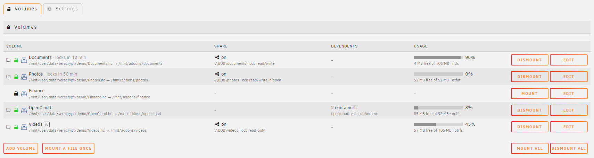
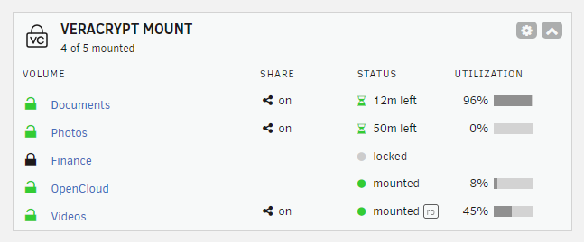
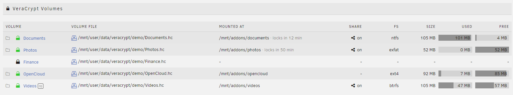
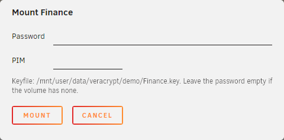

# VeraCrypt Mount for Unraid

An Unraid plugin that unlocks and mounts **VeraCrypt volumes** (container files stored
on your shares) with the `cryptsetup` that Unraid already includes. Mounted volumes can
be shared over SMB, and Docker containers that keep their data on a volume can be
started after it is mounted and stopped before it is dismounted. Volumes are
dismounted cleanly before the array stops or the server shuts down.

The volumes stay ordinary VeraCrypt volumes: you can still open them with VeraCrypt on
Windows, just not on both at once.

> **Status: beta.** Works and is tested on Unraid 7.4, but has few users yet. Try it
> with a copy of a volume before you trust it with your only one, and keep backups. An XFS volume and
> its copy cannot be mounted at the same time (they share a file system ID); the plugin
> says so and refuses the second. Btrfs copies can.

## Screenshots

The Volumes tab: shares, dependent containers, usage and the time left before an idle
volume is locked.



The Dashboard tile and the section on the Main page, each with a lock that mounts and
dismounts.





Mounting a volume that needs a PIM and a keyfile.



## Features

- **Volumes tab** (Settings › User Utilities › VeraCrypt Mount): your saved volumes
  with their share, dependents and usage; mount, dismount and edit; **Mount all**,
  **Dismount all**; **Mount a file once** for a volume that is not saved and leaves no
  trace in the plugin's settings or log.
- **Per-user SMB shares** in the manner of Unraid's "Private" shares: each user gets
  no access, read-only or read/write; the share can be hidden from network browsing.
- **Dependents:** containers that run only while their volume is mounted. They start
  in the order you set and stop in reverse, each with its own grace period before it
  is stopped by force. A dependent started while its volume is locked (by hand or by
  Docker) is stopped again within a minute, so it cannot write into the empty mount
  folder.
- **Safe dismount:** before the array stops or the server shuts down, the dependents
  are stopped and every volume is dismounted. A normal dismount never takes a volume
  away from a program or a computer that still uses it, a file open over the network
  included: it stops and says who holds it, and nothing is changed. You can then force
  it (one confirmation, which names what forcing ends). At array stop force is on by
  default, so a busy volume cannot hold up the stop.
- **Protection against double use:** a volume is not mounted while a computer has its
  file open over a Windows share (SMB), because mounting it on the server and on
  Windows at the same time destroys it. NFS clients are not checked.
- **Lock when idle** per volume: dismounted after a chosen time (5 minutes to a day)
  without reads or writes, as VeraCrypt's own auto-dismount. A file open over its share
  or a program or other container using it keeps it mounted; its own dependents do
  not. The pages show the time left.
- **Read-only switch** per volume, which also limits its share to read-only.
- **Dashboard tile** and an optional **section on the Main page**, each with a lock
  that mounts and dismounts; the Main page section also opens a mounted volume in
  Unraid's file manager.
- **`vcmount`**, a command-line tool for SSH, which is also the engine behind the
  pages. Run `vcmount help` for its commands.
- **Warning for File Activity:** if that plugin is installed and would record the
  names of files on your saved volumes, the Volumes tab shows the one exclusion line to
  add.

## Requirements and limits

- Unraid **7.4** or newer.
- VeraCrypt volumes opened with a **password** and/or **keyfiles**, optionally with a
  **PIM**, including **hidden volumes**, with **FAT32, exFAT, NTFS, ext2/3/4,
  XFS or Btrfs** inside. FAT32, exFAT and NTFS also open in VeraCrypt on Windows; ext4,
  XFS and Btrfs keep Unix owners and permissions, which containers need, but open only
  on Linux. (VeraCrypt on Windows creates only the first three; for the others, create
  the volume with VeraCrypt on Linux.)
- **TrueCrypt volumes** (VeraCrypt's predecessor) should open the same way: the unlock
  recognises both formats by itself. Tested only with cryptsetup's official TrueCrypt
  sample volumes, not yet with a real TrueCrypt volume holding files. Not supported:
  volumes from TrueCrypt before 5.0 that use a cipher cascade in CBC mode or Blowfish,
  which the Linux kernel cannot open. TrueCrypt protects the password far more weakly
  than VeraCrypt: better copy its files into a new VeraCrypt volume. (VeraCrypt up to
  version 1.25.9 can also convert one in place: Volumes > Change Volume Password, with
  "TrueCrypt mode" ticked; later versions dropped TrueCrypt mode.)
- Not built yet: mounting automatically at array start, and Docker Compose stacks as
  dependents.
- A hidden volume has no write protection on Linux: mounting its outer volume
  read-write can overwrite it. Mount the outer volume read-only.
- FAT32, exFAT and NTFS have no Unix file permissions, so some containers (databases
  especially) will not run from them; use ext4, XFS or Btrfs for those. exFAT has no journal and is the more fragile
  choice after a power cut.
- On ext4, XFS and Btrfs a new volume's top folder belongs to `root`, so its share
  cannot write at first. After mounting, the page asks whether to let the share write
  (only the top folder is changed); the volume's information window offers the same,
  plus **Fix permissions…** for everything inside (Unraid's New Permissions).
- Volumes cannot be created or their passwords changed here; use VeraCrypt for that.
- By default a volume is mounted at `/mnt/addons/<name>`, outside your shares.
  Mounting it into a folder of a share is possible, but then everything that walks
  that share (backups, indexers, activity loggers) also walks into the decrypted data.

## Install

In Unraid, open **Plugins › Install Plugin**, paste this address and click **Install**:

```
https://raw.githubusercontent.com/bentrop/unraid-veracrypt-mount/main/plugin/veracrypt.mount.plg
```

Then open **Settings › User Utilities › VeraCrypt Mount** and add a volume: a name and
its file are enough to start.

**What runs in the background:** the plugin adds one job that runs every minute as
root (`vcmount check`). It locks volumes that were idle for their set time and stops
dependents that run while their volume is locked; with nothing to do it only reads a
few files. At array start, array stop and shutdown, three small hook scripts start and
stop the dependents and dismount the volumes.

**Updates** keep mounted volumes mounted. **Uninstall** through the Plugins page: it is
refused while any volume is unlocked or mounted (dismount them first; nothing is
changed). Your list of volumes stays in
`/boot/config/plugins/veracrypt.mount/volumes.json`, so a reinstall picks it up
again.

## Security and privacy

- **The password** travels from the browser to `cryptsetup` in the body of one request
  and then on standard input only. It is never stored, never put into a command line,
  a file, a log or a notification. The plugin keeps no password on the server. A PIM
  takes the same way, right after the password; keyfiles are stored only as paths.
- **HTTPS:** the setting **Require HTTPS to mount** is **on by default**. While it is
  on, a page opened over plain HTTP offers no password field at all, because over
  plain HTTP the password would cross your network unencrypted. If you use Unraid
  without HTTPS, switch the setting off once on the plugin's Settings tab; the page
  then warns before each mount. Behind a reverse proxy that talks plain HTTP to
  Unraid, the page counts as HTTP too. Over SSH (`vcmount mount <name>`) the password is
  always encrypted on the way.
- **Review:** the password path was reviewed separately from the code that implements
  it; see [`docs/REVIEW-secrets.md`](docs/REVIEW-secrets.md).
- **What a mounted volume does not protect:** while it is mounted, anything with root
  on the server, and anyone who can log in to Unraid's web interface, can read it.
  Encryption protects the data when the volume is locked.
- **Traces the plugin cannot prevent:** a container's settings stored outside the
  volume, recent-file lists and thumbnails on Windows computers that used the share,
  activity-logging plugins that record when the volume file is opened, and the shell
  history if you use `vcmount` over SSH with a file path, and the paths of the volume
  file and its keyfiles in the process list while a volume is being unlocked (up to
  three minutes with a large PIM).
- **Keyfiles** must lie under `/mnt/` (a share, disk or removable drive). A keyfile kept
  on the same server does not protect against someone who takes the whole server.
- **Hidden volumes:** a saved volume records that its file holds a hidden volume. Use
  **Mount a file once** if nobody should be able to tell.

Found a security problem? Please report it privately, as described in
[`SECURITY.md`](SECURITY.md).

## How it was made

This is an AI-assisted project. I wrote the requirements and the design, decided every
feature and every trade-off, reviewed every change before it went in, and tested every
release on my own server with throwaway volumes.

**Security first:** the password never touches a disk, a log or a command line, and the
plugin does nothing risky without asking. The password path has been reviewed several
times, including independent AI-assisted audits whose findings were fixed and are
published in [`docs/`](docs/). There has been no professional third-party audit yet. If
you find a problem, please report it privately ([`SECURITY.md`](SECURITY.md)).

## Development

- `src/` mirrors the server's file system; `plugin/` holds the `.plg`.
- `docs/SPEC.md` holds the requirements and every test result;
  `docs/DESIGN-engine.md` and `docs/DESIGN-ui.md` describe how the engine and the
  pages work.
- **Build:** `python scripts/build.py <version>` (versions are dates, such as
  `2026.11.17`, with a letter for further builds that day) writes the package to
  `build/` and its version and SHA256 into the `.plg`. Builds are reproducible.
- **Release:** commit the `.plg` and push the version as a tag. The workflow in
  `.github/workflows/release.yml` rebuilds the package, checks it against the `.plg`
  and publishes both as a GitHub release.
- **Helper scripts** in `scripts/` copy files to a test server and run tests there.
  They read the server's address from `.secrets/server` and a test user from
  `.secrets/test-user` (one line each; `.secrets/` is never committed). Test only
  with throwaway volumes. Among them: `deployweb.sh` (copy the pages and the engine;
  `install-demo` switches to the demo volumes of `tests/volumes.demo.json` for
  screenshots), `enginetest.sh` and `actiontest.sh` (one test case each),
  `tctest.sh` (cryptsetup's TrueCrypt sample volumes) and `forcealltest.sh` (array
  stop with several volumes in use; `VCMOUNT_TRACE=1` shows the engine's timing).

## Licence

MIT, see [LICENSE](LICENSE).
